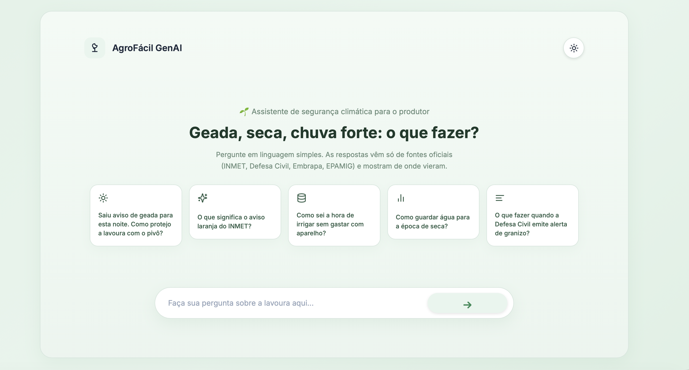
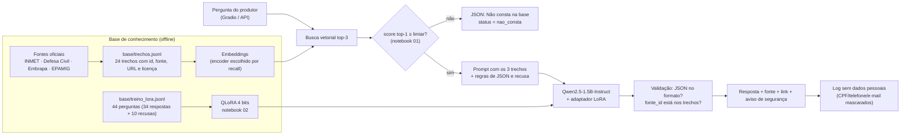

# AgroFácil GenAI

### Assistente de segurança climática para o pequeno produtor rural

**FIAP · Global Solution 2026.2 · CitizenTech · Generative AI for Engineering**

LLM local (`Qwen2.5-1.5B-Instruct`, 4 bits) com **RAG** sobre fontes oficiais (INMET, Defesa Civil, Embrapa, EPAMIG) e **especialização LoRA**. O assistente responde em **JSON validado**, **cita a fonte** e **recusa** ("Não consta na base de conhecimento.") quando a informação não está na base.

---

## 1. Integrantes

| Nome completo | RM | Papel |
| :--- | :---: | :--- |
| Julia Ortiz | RM550204 | Engenharia de prompt e RAG |
| Julia Palomari | RM551910 | Frontend e arquitetura web |
| Leticia Baptista | RM550289 | Dataset e curadoria técnica |
| Vinicius Sobreira Borges | RM97767 | Fine-tuning LoRA e pipeline de IA |

---

## 2. Ficha Técnica do MVP

| Campo | Conteúdo |
| :--- | :--- |
| **Nome do produto** | AgroFácil |
| **Cidadão e território** | Pequeno produtor rural da agricultura familiar, com pouca assistência técnica e conectividade limitada |
| **Problema, em uma frase** | O pequeno produtor perde safra, água e segurança com geada, seca e temporais porque não recebe a tempo uma orientação clara e confiável sobre o que fazer |
| **Proposta de valor** | Alertas climáticos e um assistente que responde em linguagem simples, mostra a fonte oficial e diz "não consta" quando não sabe |
| **Eixo do desafio de GenAI** | **Segurança**: segurança climática da família, da lavoura e da renda (alertas, geada, seca, granizo, vendaval). Ganho secundário em **energia**: irrigar só quando necessário evita bombeamento desnecessário |
| **O que a IA resolve** | Responde perguntas sobre como se preparar e reagir a eventos climáticos e sobre irrigação na seca, **somente** com base na base técnica, em JSON `{resposta, fonte_id, status}` |
| **Arquitetura: componentes** | Busca vetorial (encoder escolhido por recall no notebook 01) → limiar de recusa → Qwen2.5-1.5B + LoRA (4 bits) → validação de JSON e citação → interface Gradio e API FastAPI |
| **Fontes de dados** | 24 trechos de 11 fontes oficiais e técnicas ([tabela](base/tabela_base.md)); a previsão do tempo vem do componente de Dados (Open-Meteo/INMET) |
| **Modelos de IA utilizados** | `Qwen/Qwen2.5-1.5B-Instruct` (local, NF4), adaptador LoRA próprio, encoder de embeddings `all-MiniLM-L6-v2` ou `paraphrase-multilingual-MiniLM-L12-v2` (escolhido por recall@3 no notebook 01) |
| **URL do MVP e repositório** | MVP: interface Gradio, executada pelo [`notebooks/03_interface_web.ipynb`](notebooks/03_interface_web.ipynb) (gera um link público temporário a cada execução; ver as [capturas da interface](#demonstração-da-interface)) · Repositório: https://github.com/palomari/agrofacil-genai |
| **Indicadores de impacto** | % de respostas corretas com fonte; % de alucinação em perguntas fora da base ([placar](avaliacao/placar_comparativo.md)); produtores alertados antes do evento; perdas evitadas (estimativa com os produtores) |
| **ODS conectados** | **ODS 2** (agricultura sustentável e segurança alimentar), **ODS 13** (adaptação a eventos climáticos extremos), **ODS 10** (acesso à informação técnica por quem tem menos assistência) |

### Demonstração da interface

Capturas da interface Gradio rodando no Colab (GPU T4) com o sistema final (RAG + LoRA + limiar). O link público do Gradio dura só enquanto o notebook 03 está em execução; para usar a interface, rode [`notebooks/03_interface_web.ipynb`](notebooks/03_interface_web.ipynb).

| Tela inicial, com sugestões de perguntas | Geração da resposta pelo LLM local |
| :---: | :---: |
|  |  |

| Pergunta sobre geada: resposta com a fonte T06 e o aviso de segurança | Pergunta sobre seca: resposta com a fonte T14 e o aviso de segurança |
| :---: | :---: |
|  |  |

Na captura da geada, a resposta repete "por volta das 3h da madrugada" duas vezes. É uma limitação do modelo de 1,5B do mesmo tipo do erro 2 (ver os 5 erros). As recusas ("Não consta na base de conhecimento.") aparecem na saída salva do notebook 03 e na seção "Demonstração de alucinações" do notebook 04.

---

## 3. Diagrama do pipeline de IA e dos documentos



O código do pipeline fica em um único módulo, [`src/agrofacil.py`](src/agrofacil.py). Notebooks, interface e API importam o mesmo código, então **o que é avaliado é o que roda no produto**.

---

## 4. Tabela da base

| Fonte | Formato | Licença / uso | Trechos |
| :--- | :--- | :--- | ---: |
| INMET: Aviso meteorológico ou alerta? | Texto parafraseado (JSONL) | Conteúdo público federal, com citação | 3 |
| Revista Cultivar: Irrigação contra geada (2017) | Texto parafraseado (JSONL) | Jornalístico (direitos reservados); só resumo com citação | 4 |
| EPAMIG: Circular Técnica 210, irrigação na seca | Texto parafraseado (JSONL) | Publicação técnica de acesso livre | 3 |
| Embrapa: irrigação na agricultura familiar no semiárido | Texto parafraseado (JSONL) | Acesso aberto (Alice/Embrapa) | 3 |
| O Povo/Embrapa: ações contra a seca no Nordeste (2026) | Texto parafraseado (JSONL) | Jornalístico (direitos reservados); só resumo com citação | 4 |
| Embrapa: Folder Zarc (2021) | Texto parafraseado (JSONL) | Acesso aberto (Infoteca/Embrapa) | 1 |
| Revista Cultivar/Embrapa Soja: El Niño na soja (2026) | Texto parafraseado (JSONL) | Jornalístico (direitos reservados); só resumo com citação | 2 |
| Defesa Civil RS: granizo / vendaval | Texto parafraseado (JSONL) | Conteúdo público estadual | 2 |
| Defesa Civil RJ: vendavais | Texto parafraseado (JSONL) | Conteúdo público estadual | 1 |
| Prefeitura de Curitiba/Defesa Civil: telefones | Texto parafraseado (JSONL) | Conteúdo público municipal | 1 |
| **Total** | | | **24** |

Tabela completa, com links e IDs: [`base/tabela_base.md`](base/tabela_base.md).

**Casos de teste:** [`avaliacao/casos_teste.json`](avaliacao/casos_teste.json), com 37 casos: 27 com resposta na base (gabarito, termos-chave e id do trecho esperado) e 10 "não consta", incluindo armadilhas do próprio tema (preço do adubo, dose de glifosato, "vai gear amanhã?"). As perguntas de treino do LoRA e de validação do limiar ficam em outro arquivo e **não se repetem** no teste (há um `assert` nos notebooks que garante isso).

---

## 5. Performance do modelo

Todos os números abaixo foram gerados pelos notebooks 01 e 04 (GPU T4, geração determinística) e estão em [`avaliacao/`](avaliacao/).

**Busca** (notebook 01, [`avaliacao/recall.csv`](avaliacao/recall.csv), 27 perguntas com resposta na base):

| Encoder | recall@1 | recall@3 |
| :--- | ---: | ---: |
| **all-MiniLM-L6-v2 (escolhido)** | **0,704** | **0,926** |
| paraphrase-multilingual-MiniLM-L12-v2 | 0,667 | 0,889 |

Critério: maior recall@3, porque o LLM recebe os 3 trechos, com desempate pelo recall@1. A diferença é de 1 pergunta em 27.

**Limiar: 0,425**, escolhido no conjunto de validação (perguntas do treino, não do teste) como o maior valor que mantém ≥ 95% das perguntas respondíveis ([`limiar.csv`](avaliacao/limiar.csv), [`limiar.png`](avaliacao/limiar.png)).

**Placar das configurações** (notebook 04, 37 casos: 27 com resposta na base e 10 "não consta"; tabela completa em [`placar_comparativo.md`](avaliacao/placar_comparativo.md)):

| Configuração | JSON válido | Resposta correta | Correta + citação certa | Recusa correta (não consta) | Alucinação fora da base | Resposta errada afirmada | Recusa indevida | Latência |
| :--- | ---: | ---: | ---: | ---: | ---: | ---: | ---: | ---: |
| C1 · LLM base sem contexto | 16,2% | 0,0% | 0,0% | 0,0% | 30,0% | 11,1% | 0,0% | 2,9 s |
| C2 · RAG simples | 91,9% | 44,4% | 25,9% | 100% | 0,0% | 0,0% | 44,4% | 4,0 s |
| C3 · RAG + LoRA | **100%** | **81,5%** | **74,1%** | **100%** | **0,0%** | 14,8% | 3,7% | 7,8 s |
| Sistema final (C3 + limiar) | **100%** | **81,5%** | **74,1%** | **100%** | **0,0%** | 14,8% | 3,7% | 7,6 s |

**Interpretação:**

- **O LLM sozinho (C1) não serve para o produtor.** Ele não segue o formato (84% das saídas sem JSON válido), não tem fonte para citar e inventa respostas. Nos casos "não consta", deu faixas de preço para o adubo (R$ 10 a 20 o saco), "100 a 250 litros de glifosato por hectare" e "R$ 500 a 2.000 por hectare" de seguro rural, todos números sem nenhuma base. A métrica de 30% de alucinação **subestima** o problema, porque várias invenções vieram em JSON inválido e por isso não contam como "afirmadas".
- **O RAG simples (C2) elimina a alucinação, mas fica inseguro demais.** O modelo base recusa 44% das perguntas que tinham resposta. Em vários casos, ele escreveu a resposta certa e mesmo assim marcou `"status": "nao_consta"` (por exemplo, a geada nas baixadas), e às vezes citou a fonte fora do formato (`"fonte_id": 22` em vez de `"T23"`).
- **O LoRA (C3) é o maior ganho do projeto.** A resposta correta com citação certa sobe de 25,9% para **74,1%**, o JSON fica 100% válido e a recusa indevida cai de 44,4% para **3,7%**, mantendo **100% de recusa** nas perguntas fora da base. O custo é latência (7,8 s contra 4,0 s), porque as respostas ficam mais completas.
- **O limiar não mudou o placar no teste.** Com o encoder escolhido, as perguntas em português recebem scores parecidos, dentro ou fora da base (deputados: 0,56; preço do adubo: 0,60). O limiar barrou só "Vai gear amanhã em Curitiba?" (0,379) e economizou essa chamada ao LLM; todas as outras recusas vieram do modelo treinado. O encoder multilíngue separava muito melhor as perguntas fora da base (no notebook 01, recusava 60% delas no limiar, contra 10%), ao custo de 1 pergunta a menos no recall@3. É um *trade-off* a reavaliar com uma base maior.
- **O erro restante mais importante é a "resposta errada afirmada" (14,8%).** O modelo responde com segurança a partir do trecho errado ou omite a parte essencial. Ver os 5 erros.

**Demonstração de alucinações:** a seção "Demonstração de alucinações" do notebook 04 mostra, pergunta a pergunta, a resposta inventada pelo C1 ao lado da recusa do sistema final.

---

## 6. Os 5 erros, a causa e a correção proposta

Ver [`avaliacao/5erros.md`](avaliacao/5erros.md). Resumo dos 5 erros reais do sistema final:

| # | Caso | Erro | Causa | Correção |
| :---: | :--- | :--- | :--- | :--- |
| 1 | 27: número da Defesa Civil | Respondeu 40199 (SMS) em vez de 199 | T03 ficou em 1º na busca; o modelo usou o trecho mais parecido | Título do T24 com "telefone/ligar", busca híbrida e exemplos de treino; o aviso fixo já mostra 199/193 |
| 2 | 9: irrigar na véspera da geada | "Irrigue no dia seguinte": instrução inventada | Modelo pequeno resume demais e completa a frase | Treino com respostas que mantêm o porquê; checagem de fidelidade ao trecho |
| 3 | 16: cova da bananeira | Respondeu sobre cobertura do solo (T16) | T13 fora do top-3 (busca) e o modelo não recusou | Busca híbrida (BM25 + vetorial); treinar a recusa quando o trecho não responde |
| 4 | 23: erosão com chuva | "Não consta" com resposta na base | T19/T20 fora do top-3: "chove demais" x "excesso de chuva" | Encoder multilíngue ou híbrido; sinônimos no texto do trecho |
| 5 | 11: Hargreaves | Resposta certa, citou T08 em vez de T09 | Trechos vizinhos da mesma fonte | Validar a citação pela sobreposição do texto e corrigir o id |

---

## 7. IA responsável e LGPD

- **Explicável:** toda resposta traz o `fonte_id`, o nome da fonte, o link e os scores dos trechos recuperados. O sistema confere se a fonte citada está mesmo entre os trechos usados.
- **Recusa em duas camadas:** limiar de similaridade e LLM treinado para dizer "não consta".
- **Pessoa no circuito:** toda resposta vem com aviso de que a orientação não substitui a Defesa Civil nem a assistência técnica, e com os telefones 199 e 193. O assistente não dá dose de produto nem recomendação comercial (esses casos estão no teste como "não consta").
- **LGPD by design:** a pergunta não é armazenada; o log de operação mascara CPF, telefone e e-mail (`mascarar_pii`); nenhum dado pessoal está no repositório. Não há credenciais no código.
- **Vieses e limites:** a base cobre sobretudo Sul, Sudeste e semiárido; perguntas de outros biomas tendem a cair em "não consta". O gabarito por termos-chave é uma métrica conservadora: uma resposta correta com outras palavras pode ser contada como erro.

---

## 8. Como reproduzir

Ambiente: **Google Colab com GPU T4** (ou Python 3.10+ com GPU CUDA).

```bash
git clone https://github.com/palomari/agrofacil-genai.git
cd agrofacil-genai
pip install -r requirements.txt
```

Rode os notebooks **nesta ordem**, na mesma conta Google. No Colab, a primeira célula monta o Google Drive e clona o repositório em `MyDrive/agrofacil-genai`, para que todos os notebooks compartilhem o limiar salvo no 01 e o adaptador LoRA treinado no 02. O adaptador já treinado está em `modelos/agrofacil_adapter/`, então para só avaliar ou abrir a interface é possível pular o notebook 02.

| # | Notebook | O que faz | Gera |
| :---: | :--- | :--- | :--- |
| 1 | `notebooks/01_rag_pipeline.ipynb` | base, recall@1/@3, escolha do limiar, demonstração do JSON | `avaliacao/recall.csv`, `limiar.csv`, `limiar.png`, `config_rag.json` |
| 2 | `notebooks/02_especializacao.ipynb` | treino QLoRA | `modelos/agrofacil_adapter/`, `avaliacao/treino_lora_log.csv` |
| 3 | `notebooks/04_avaliacao.ipynb` | placar C1/C2/C3/final, alucinações, erros | `avaliacao/placar_comparativo.md`, `placar.csv`, `resultados/`, `erros_candidatos.csv` |
| 4 | `notebooks/03_interface_web.ipynb` | interface Gradio (+ API opcional) | link público temporário do Gradio |

Depois de rodar, faça o commit dos notebooks **com as saídas salvas**, da pasta `avaliacao/` e de `modelos/agrofacil_adapter/`.

**API:**

```bash
uvicorn api.app:app --host 0.0.0.0 --port 8000
curl -X POST localhost:8000/perguntar -H "Content-Type: application/json" \
     -d '{"pergunta": "O que fazer quando sai aviso de geada?"}'
```

Resposta (formato):

```json
{"resposta": "...", "status": "ok", "fonte_id": "T06", "fonte": "...", "url": "https://...",
 "score_top1": 0.71, "trechos_recuperados": [{"id": "T06", "score": 0.71}], "aviso": "..."}
```

---

## 9. Estrutura do repositório

```text
agrofacil-genai/
├── src/agrofacil.py            # pipeline único: busca, prompt, geração, JSON, recusa, métricas, LGPD
├── api/app.py                  # API FastAPI (/saude, /perguntar)
├── base/
│   ├── trechos.jsonl           # base de conhecimento (24 trechos com fonte, URL e licença)
│   ├── treino_lora.jsonl       # perguntas de treino/validação (fora do teste)
│   └── tabela_base.md          # fonte, formato, licença e nº de trechos
├── avaliacao/
│   ├── casos_teste.json        # 37 casos com gabarito, incluindo "não consta"
│   ├── placar_comparativo.md   # gerado pelo notebook 04
│   └── 5erros.md               # análise dos erros reais
├── notebooks/                  # 01 RAG · 02 LoRA · 03 interface · 04 avaliação
├── modelos/agrofacil_adapter/  # adaptador LoRA (gerado pelo notebook 02)
└── requirements.txt
```

---

## 10. Conclusão técnica

A melhor configuração é **RAG + LoRA** (C3, igual ao sistema final): 74,1% de respostas corretas com a fonte certa, 100% de JSON válido e **100% de recusa** nas perguntas fora da base, contra 0% de acerto e respostas inventadas do LLM sozinho. O RAG resolveu a alucinação, mas com o modelo base ficou inseguro demais (44% de recusas indevidas); o LoRA, treinado com apenas 44 exemplos montados com o mesmo prompt do sistema, foi o que trouxe formato, citação e confiança. O principal erro restante é responder com segurança a partir do trecho errado (14,8%), causado sobretudo pela busca, e ele pesa mais em perguntas de emergência (caso do telefone). Os próximos passos são: busca híbrida (BM25 + vetorial) e reavaliação do encoder multilíngue; ampliar a base para outros biomas; checar automaticamente se cada frase da resposta está no trecho citado; e integrar os avisos do INMET em tempo real, que hoje caem corretamente em "não consta".

**Links:** repositório https://github.com/palomari/agrofacil-genai · MVP: [capturas da interface](#demonstração-da-interface) e [`notebooks/03_interface_web.ipynb`](notebooks/03_interface_web.ipynb)
