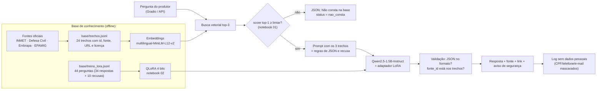

# AgroFácil GenAI

### Assistente de segurança climática para o pequeno produtor rural

**FIAP · Global Solution 2026.2 · CitizenTech · Generative AI for Engineering**

LLM local (`Qwen2.5-1.5B-Instruct`, 4 bits) com **RAG** sobre fontes oficiais (INMET, Defesa Civil, Embrapa, EPAMIG) e **especialização LoRA**. O assistente responde em **JSON validado**, **cita a fonte** e **recusa** ("Não consta na base de conhecimento.") quando a informação não está na base.

---

## 1. Integrantes

| Nome completo | RM | Papel |
| :--- | :---: | :--- |
| Julia Ortiz | RM550204 | Engenharia de prompt e RAG |
| Julia Palomari | RM551910 | Frontend e arquitetura web |
| Leticia Baptista | RM550289 | Dataset e curadoria técnica |
| Vinicius Sobreira Borges | RM97767 | Fine-tuning LoRA e pipeline de IA |

---

## 2. Ficha Técnica do MVP

| Campo | Conteúdo |
| :--- | :--- |
| **Nome do produto** | AgroFácil |
| **Cidadão e território** | Pequeno produtor rural da agricultura familiar, com pouca assistência técnica e conectividade limitada |
| **Problema, em uma frase** | O pequeno produtor perde safra, água e segurança com geada, seca e temporais porque não recebe a tempo uma orientação clara e confiável sobre o que fazer |
| **Proposta de valor** | Alertas climáticos e um assistente que responde em linguagem simples, mostra a fonte oficial e diz "não consta" quando não sabe |
| **Eixo do desafio de GenAI** | **Segurança**: segurança climática da família, da lavoura e da renda (alertas, geada, seca, granizo, vendaval). Ganho secundário em **energia**: irrigar só quando necessário evita bombeamento desnecessário |
| **O que a IA resolve** | Responde perguntas sobre como se preparar e reagir a eventos climáticos e sobre irrigação na seca, **somente** com base na base técnica, em JSON `{resposta, fonte_id, status}` |
| **Arquitetura: componentes** | Busca vetorial (encoder multilíngue) → limiar de recusa → Qwen2.5-1.5B + LoRA (4 bits) → validação de JSON e citação → interface Gradio e API FastAPI |
| **Fontes de dados** | 24 trechos de 11 fontes oficiais e técnicas ([tabela](base/tabela_base.md)); a previsão do tempo vem do componente de Dados (Open-Meteo/INMET) |
| **Modelos de IA utilizados** | `Qwen/Qwen2.5-1.5B-Instruct` (local, NF4), adaptador LoRA próprio, `paraphrase-multilingual-MiniLM-L12-v2` (embeddings) |
| **URL do MVP e repositório** | ⚠️ PREENCHER: link do MVP · https://github.com/palomari/agrofacil-genai |
| **Indicadores de impacto** | % de respostas corretas com fonte; % de alucinação em perguntas fora da base ([placar](avaliacao/placar_comparativo.md)); produtores alertados antes do evento; perdas evitadas (estimativa com os produtores) |
| **ODS conectados** | **ODS 2** (agricultura sustentável e segurança alimentar), **ODS 13** (adaptação a eventos climáticos extremos), **ODS 10** (acesso à informação técnica por quem tem menos assistência) |

---

## 3. Diagrama do pipeline de IA e dos documentos



O código do pipeline fica em um único módulo, [`src/agrofacil.py`](src/agrofacil.py). Notebooks, interface e API importam o mesmo código, então **o que é avaliado é o que roda no produto**.

---

## 4. Tabela da base

| Fonte | Formato | Licença / uso | Trechos |
| :--- | :--- | :--- | ---: |
| INMET: Aviso meteorológico ou alerta? | Texto parafraseado (JSONL) | Conteúdo público federal, com citação | 3 |
| Revista Cultivar: Irrigação contra geada (2017) | Texto parafraseado (JSONL) | Jornalístico (direitos reservados); só resumo com citação | 4 |
| EPAMIG: Circular Técnica 210, irrigação na seca | Texto parafraseado (JSONL) | Publicação técnica de acesso livre | 3 |
| Embrapa: irrigação na agricultura familiar no semiárido | Texto parafraseado (JSONL) | Acesso aberto (Alice/Embrapa) | 3 |
| O Povo/Embrapa: ações contra a seca no Nordeste (2026) | Texto parafraseado (JSONL) | Jornalístico (direitos reservados); só resumo com citação | 4 |
| Embrapa: Folder Zarc (2021) | Texto parafraseado (JSONL) | Acesso aberto (Infoteca/Embrapa) | 1 |
| Revista Cultivar/Embrapa Soja: El Niño na soja (2026) | Texto parafraseado (JSONL) | Jornalístico (direitos reservados); só resumo com citação | 2 |
| Defesa Civil RS: granizo / vendaval | Texto parafraseado (JSONL) | Conteúdo público estadual | 2 |
| Defesa Civil RJ: vendavais | Texto parafraseado (JSONL) | Conteúdo público estadual | 1 |
| Prefeitura de Curitiba/Defesa Civil: telefones | Texto parafraseado (JSONL) | Conteúdo público municipal | 1 |
| **Total** | | | **24** |

Tabela completa, com links e IDs: [`base/tabela_base.md`](base/tabela_base.md).

**Casos de teste:** [`avaliacao/casos_teste.json`](avaliacao/casos_teste.json), com 37 casos: 27 com resposta na base (gabarito, termos-chave e id do trecho esperado) e 10 "não consta", incluindo armadilhas do próprio tema (preço do adubo, dose de glifosato, "vai gear amanhã?"). As perguntas de treino do LoRA e de validação do limiar ficam em outro arquivo e **não se repetem** no teste (há um `assert` nos notebooks que garante isso).

---

## 5. Performance do modelo

> ⚠️ **PREENCHER** com a tabela gerada em [`avaliacao/placar_comparativo.md`](avaliacao/placar_comparativo.md), depois de rodar o notebook 04. Não editar os números à mão.

**Busca** (notebook 01, [`avaliacao/recall.csv`](avaliacao/recall.csv)):

| Encoder | recall@1 | recall@3 |
| :--- | ---: | ---: |
| all-MiniLM-L6-v2 (versão anterior) | ⚠️ | ⚠️ |
| paraphrase-multilingual-MiniLM-L12-v2 | ⚠️ | ⚠️ |

**Limiar:** ⚠️ ___ (escolhido no conjunto de validação como o maior valor que mantém ≥ 95% das perguntas respondíveis; ver [`avaliacao/limiar.png`](avaliacao/limiar.png)).

**Placar das configurações** (notebook 04):

| Configuração | JSON válido | Correta + citação | Recusa correta | Alucinação fora da base | Recusa indevida |
| :--- | ---: | ---: | ---: | ---: | ---: |
| C1 · LLM base sem contexto | ⚠️ | ⚠️ | ⚠️ | ⚠️ | ⚠️ |
| C2 · RAG simples | ⚠️ | ⚠️ | ⚠️ | ⚠️ | ⚠️ |
| C3 · RAG + LoRA | ⚠️ | ⚠️ | ⚠️ | ⚠️ | ⚠️ |
| Sistema final (C3 + limiar) | ⚠️ | ⚠️ | ⚠️ | ⚠️ | ⚠️ |

**Interpretação:** ⚠️ copiar e revisar o texto gerado em `placar_comparativo.md`.

**Demonstração de alucinações:** a penúltima seção do notebook 04 mostra, para cada pergunta "não consta", a resposta inventada pelo LLM sem contexto ao lado da recusa do sistema final.

---

## 6. Os 5 erros, a causa e a correção proposta

Ver [`avaliacao/5erros.md`](avaliacao/5erros.md) (⚠️ preencher com os erros reais de `avaliacao/erros_candidatos.csv`).

---

## 7. IA responsável e LGPD

- **Explicável:** toda resposta traz o `fonte_id`, o nome da fonte, o link e os scores dos trechos recuperados. O sistema confere se a fonte citada está mesmo entre os trechos usados.
- **Recusa em duas camadas:** limiar de similaridade e LLM treinado para dizer "não consta".
- **Pessoa no circuito:** toda resposta vem com aviso de que a orientação não substitui a Defesa Civil nem a assistência técnica, e com os telefones 199 e 193. O assistente não dá dose de produto nem recomendação comercial (esses casos estão no teste como "não consta").
- **LGPD by design:** a pergunta não é armazenada; o log de operação mascara CPF, telefone e e-mail (`mascarar_pii`); nenhum dado pessoal está no repositório. Não há credenciais no código.
- **Vieses e limites:** a base cobre sobretudo Sul, Sudeste e semiárido; perguntas de outros biomas tendem a cair em "não consta". O gabarito por termos-chave é uma métrica conservadora: uma resposta correta com outras palavras pode ser contada como erro.

---

## 8. Como reproduzir

Ambiente: **Google Colab com GPU T4** (ou Python 3.10+ com GPU CUDA).

```bash
git clone https://github.com/palomari/agrofacil-genai.git
cd agrofacil-genai
pip install -r requirements.txt
```

Rode os notebooks **nesta ordem**. Cada um clona o repositório sozinho se for aberto direto no Colab.

| # | Notebook | O que faz | Gera |
| :---: | :--- | :--- | :--- |
| 1 | `notebooks/01_rag_pipeline.ipynb` | base, recall@1/@3, escolha do limiar, demonstração do JSON | `avaliacao/recall.csv`, `limiar.csv`, `limiar.png`, `config_rag.json` |
| 2 | `notebooks/02_especializacao.ipynb` | treino QLoRA | `modelos/agrofacil_adapter/`, `avaliacao/treino_lora_log.csv` |
| 3 | `notebooks/04_avaliacao.ipynb` | placar C1/C2/C3/final, alucinações, erros | `avaliacao/placar_comparativo.md`, `placar.csv`, `resultados/`, `erros_candidatos.csv` |
| 4 | `notebooks/03_interface_web.ipynb` | interface Gradio (+ API opcional) | link público temporário do Gradio |

Depois de rodar, faça o commit dos notebooks **com as saídas salvas**, da pasta `avaliacao/` e de `modelos/agrofacil_adapter/`.

**API:**

```bash
uvicorn api.app:app --host 0.0.0.0 --port 8000
curl -X POST localhost:8000/perguntar -H "Content-Type: application/json" \
     -d '{"pergunta": "O que fazer quando sai aviso de geada?"}'
```

Resposta (formato):

```json
{"resposta": "...", "status": "ok", "fonte_id": "T06", "fonte": "...", "url": "https://...",
 "score_top1": 0.71, "trechos_recuperados": [{"id": "T06", "score": 0.71}], "aviso": "..."}
```

---

## 9. Estrutura do repositório

```text
agrofacil-genai/
├── src/agrofacil.py            # pipeline único: busca, prompt, geração, JSON, recusa, métricas, LGPD
├── api/app.py                  # API FastAPI (/saude, /perguntar)
├── base/
│   ├── trechos.jsonl           # base de conhecimento (24 trechos com fonte, URL e licença)
│   ├── treino_lora.jsonl       # perguntas de treino/validação (fora do teste)
│   └── tabela_base.md          # fonte, formato, licença e nº de trechos
├── avaliacao/
│   ├── casos_teste.json        # 37 casos com gabarito, incluindo "não consta"
│   ├── placar_comparativo.md   # gerado pelo notebook 04
│   └── 5erros.md               # análise dos erros reais
├── notebooks/                  # 01 RAG · 02 LoRA · 03 interface · 04 avaliação
├── modelos/agrofacil_adapter/  # adaptador LoRA (gerado pelo notebook 02)
└── requirements.txt
```

---

## 10. Conclusão técnica

> ⚠️ **PREENCHER** depois da avaliação (3 a 5 frases): qual configuração venceu e por quê, o quanto o RAG reduziu a alucinação em relação ao modelo sozinho, o que o LoRA acrescentou (formato, citação, recusa), qual o principal tipo de erro restante e qual o próximo passo (por exemplo, ampliar a base para outros biomas e integrar os avisos do INMET em tempo real).

**Links:** repositório https://github.com/palomari/agrofacil-genai · vídeo ⚠️ PREENCHER
