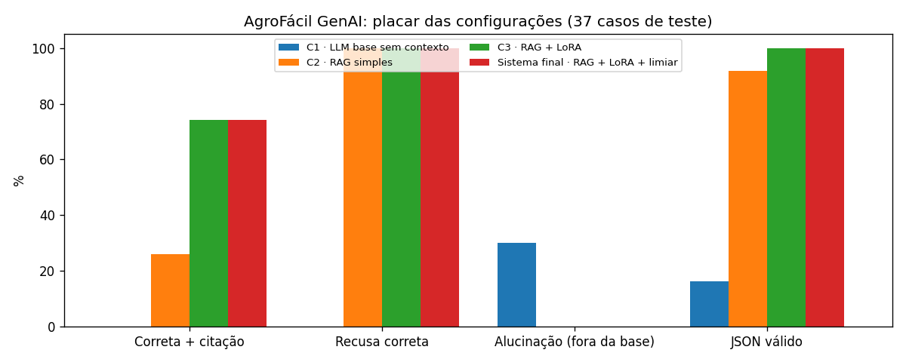

# Placar comparativo: AgroFácil GenAI

Gerado automaticamente por `notebooks/04_avaliacao.ipynb` em 18/11/2026.
Modelo: `Qwen/Qwen2.5-1.5B-Instruct` (4 bits NF4) · Encoder: `sentence-transformers/all-MiniLM-L6-v2` · k = 3 · limiar = 0.425
Casos: 37 (27 com resposta na base, 10 "não consta").

## Tabela

| configuracao | json_valido_% | resposta_correta_% | resposta_com_citacao_correta_% | recusa_correta_nao_consta_% | alucinacao_nao_consta_% | resposta_errada_afirmada_% | recusa_indevida_% | acerto_geral_% | latencia_media_s |
| :--- | ---: | ---: | ---: | ---: | ---: | ---: | ---: | ---: | ---: |
| C1 · LLM base sem contexto | 16.2 | 0.0 | 0.0 | 0.0 | 30.0 | 11.1 | 0.0 | 0.0 | 2.85 |
| C2 · RAG simples | 91.9 | 44.4 | 25.9 | 100.0 | 0.0 | 0.0 | 44.4 | 45.9 | 3.98 |
| C3 · RAG + LoRA | 100.0 | 81.5 | 74.1 | 100.0 | 0.0 | 14.8 | 3.7 | 81.1 | 7.79 |
| Sistema final · RAG + LoRA + limiar | 100.0 | 81.5 | 74.1 | 100.0 | 0.0 | 14.8 | 3.7 | 81.1 | 7.63 |

## Interpretação

- **Base vs. RAG:** a resposta correta com citação vai de 0.0% (C1, que não tem fonte para citar) para 25.9% no RAG simples; a resposta correta sem exigir citação vai de 0.0% para 44.4%.
- **Alucinação fora da base:** C1 inventa resposta em 30.0% das perguntas 'não consta', C2 em 0.0%, C3 em 0.0% e o sistema final em 0.0%.
- **Efeito do LoRA (C2 → C3):** JSON válido 91.9% → 100.0%; correta + citação 25.9% → 74.1%; recusa correta 100.0% → 100.0%; recusa indevida 44.4% → 3.7%.
- **Efeito do limiar (C3 → final):** recusa correta 100.0% → 100.0%, com recusa indevida 3.7% → 3.7% (o custo de recusar mais).
- **Latência média por pergunta (T4):** C1 2.85 s, C2 3.98 s, C3 7.79 s, final 7.63 s.

## Arquivos

- Respostas completas de cada configuração: `avaliacao/resultados/*.jsonl`
- Detalhe por caso: `avaliacao/detalhe_por_caso.csv`
- Candidatos a erro com causa provável: `avaliacao/erros_candidatos.csv`
